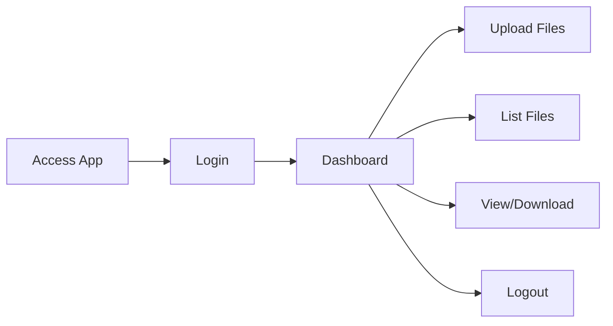

# 🔒 Flask File Upload & Access Security Testing

[](https://www.python.org/downloads/)
[](https://flask.palletsprojects.com/)
[](LICENSE)
[](#-security-tests)

A comprehensive Flask web application demonstrating secure file upload and access controls with extensive security testing to identify and prevent common web application vulnerabilities.

> **⚠️ Educational Purpose**: This application is designed for learning and security testing. Implement additional security measures for production environments.

## 📋 Table of Contents

- [Overview](#-overview)
- [Features](#-features)
- [Security Implementations](#-security-implementations)
- [Prerequisites](#-prerequisites)
- [Installation](#-installation)
- [Usage](#-usage)
- [API Endpoints](#-api-endpoints)
- [Testing](#-testing)
- [Project Structure](#-project-structure)
- [Configuration](#-configuration)
- [Contributing](#-contributing)
- [License](#-license)
- [Resources](#-resources)

## 🎯 Overview

This Flask application serves as an **educational platform** for understanding web application security vulnerabilities and secure coding practices. It demonstrates proper implementation of:

- ✅ **Authentication & Session Management**
- ✅ **Secure File Upload Handling**
- ✅ **Path Traversal Protection**
- ✅ **Input Validation & Sanitization**
- ✅ **Access Control Mechanisms**

### Key Objectives

| Goal | Description |
|------|-------------|
| 🎓 **Educational** | Demonstrate common security vulnerabilities and their mitigation strategies |
| 🧪 **Testing** | Provide comprehensive security testing framework with real-world attack scenarios |
| 🏆 **Best Practices** | Showcase Flask security implementation patterns following OWASP guidelines |
| 📚 **Documentation** | Serve as a reference for secure web application development |

## ✨ Features

### Core Functionality
- 🔐 **Secure Authentication System** with session management
- 📤 **File Upload** with validation and sanitization
- 📁 **File Management** (view, download, list files)
- 🛡️ **Security Headers** implementation
- 🎨 **Template-based UI** using Jinja2
- ⚡ **Flash Messaging** system for user feedback

### Security Features
- ✅ **Authentication Required** for all file operations
- ✅ **File Type Validation** (configurable allowed extensions)
- ✅ **File Size Limits** (16MB default)
- ✅ **Path Traversal Protection**
- ✅ **Filename Sanitization**
- ✅ **Security Headers** (XSS, CSRF, Clickjacking protection)
- ✅ **Input Validation** and error handling

## 🛡️ Security Implementations

| Security Measure | Implementation | OWASP Category | Status |
|------------------|----------------|----------------|---------|
| Authentication | Session-based login with `login_required` decorator | A07:2021 - Auth Failures | ✅ Implemented |
| Path Traversal Protection | `is_safe_path()` validation | A01:2021 - Broken Access | ✅ Implemented |
| File Type Validation | Extension whitelist (`.txt`, `.pdf`, `.png`, etc.) | A03:2021 - Injection | ✅ Implemented |
| File Size Limits | 16MB maximum upload size | A04:2021 - Insecure Design | ✅ Implemented |
| Filename Sanitization | `secure_filename()` from Werkzeug | A03:2021 - Injection | ✅ Implemented |
| Security Headers | `X-Frame-Options`, `X-XSS-Protection`, `HSTS` | A05:2021 - Security Config | ✅ Implemented |
| Input Validation | Form data validation and error handling | A03:2021 - Injection | ✅ Implemented |
| Session Security | Cryptographic secret key with `secrets.token_hex()` | A07:2021 - Auth Failures | ✅ Implemented |

## 📋 Prerequisites

Before you begin, ensure you have the following installed:

- **Python**: 3.8 or higher ([Download Python](https://www.python.org/downloads/))
- **pip**: Python package installer (included with Python 3.4+)
- **Git**: Version control system ([Download Git](https://git-scm.com/downloads))

### Verify Installation

```bash
python --version  # Should show Python 3.8+
pip --version     # Should show pip version
```

## 🚀 Installation

### 1. Clone the Repository

```bash
git clone <repository_url>
cd flask_file_exposure_testing
```

### 2. Create Virtual Environment (Recommended)

**macOS/Linux:**
```bash
python3 -m venv venv
source venv/bin/activate
```

**Windows:**
```bash
python -m venv venv
venv\Scripts\activate
```

### 3. Install Dependencies

```bash
pip install -r requirements.txt
```

**Or install manually:**
```bash
pip install flask werkzeug
```

### 4. Verify Installation

```bash
python -c "import flask; print(f'Flask {flask.__version__} installed successfully')"
```

## 💻 Usage

### Starting the Application

**Development Mode:**
```bash
python app.py
```

The application will be available at: **`http://localhost:5000`**

**Production Mode (with Gunicorn):**
```bash
pip install gunicorn
gunicorn -w 4 -b 0.0.0.0:5000 app:app
```

### Demo Credentials

| Field | Value |
|-------|-------|
| **Username** | `admin` |
| **Password** | `secure_password_123` |

> 🔐 **Security Note**: Change default credentials before any production deployment.

### Application Workflow



1. **Login**: Navigate to `http://localhost:5000/login` and enter credentials
2. **Upload Files**: Use the secure upload form with allowed file types
3. **Manage Files**: View list of uploaded files at `/list-files`
4. **View Content**: View text file content directly in browser
5. **Download**: Download files securely via `/files/<filename>`
6. **Logout**: Clear session and return to login page

### Quick Start Example

```bash
# Start the application
python app.py

# In another terminal, test with curl
curl -c cookies.txt -X POST http://localhost:5000/login \
  -d "username=admin&password=secure_password_123"

# Upload a file
curl -b cookies.txt -F "file=@test.txt" http://localhost:5000/upload

# List files
curl -b cookies.txt http://localhost:5000/list-files
```

## 🧪 Testing

The project includes comprehensive security testing through `app_test.py` using Python's `unittest` framework.

### Running Tests

**Execute all security tests:**
```bash
python app_test.py
```

**Run specific test:**
```bash
python -m unittest app_test.TestFlaskApp.test_path_traversal_vulnerability
```

**Run with verbose output:**
```bash
python -m unittest app_test.TestFlaskApp -v
```

### Test Categories

| Test Suite | Description | Attack Vectors Tested |
|------------|-------------|-----------------------|
| **Authentication Tests** | Validates login/logout functionality | Invalid credentials, session management, protected routes |
| **Path Traversal Tests** | Tests directory traversal prevention | `../`, `../../etc/passwd`, source code access |
| **File Upload Tests** | Tests malicious file upload prevention | `.php`, `.exe`, oversized files, invalid types |
| **File Access Tests** | Tests unauthorized file access | Direct URL access, system files, cross-user access |
| **Protected File Tests** | Comprehensive access control testing | Auth bypass, privilege escalation |

### Expected Test Output

```
=== AUTHENTICATION SECURITY TEST ===
Invalid login test - Status: 200
✅ SECURE: Invalid credentials properly rejected
Valid login test - Status: 200
✅ SECURE: Valid credentials accepted
✅ SECURE: Protected routes accessible after authentication

=== PATH TRAVERSAL SECURITY TEST ===
✅ SECURE: Unauthenticated access properly blocked
✅ SECURE: System file ../app.py access blocked
✅ SECURE: System file ../../etc/passwd access blocked
✅ OVERALL: All system file access properly blocked

.....
----------------------------------------------------------------------
Ran 5 tests in 0.234s

OK
```

### Security Test Coverage

| Vulnerability Type | Status | Test Method |
|-------------------|---------|-------------|
| Authentication Bypass | ✅ **Prevented** | `test_authentication_system` |
| Path Traversal | ✅ **Prevented** | `test_path_traversal_vulnerability` |
| Malicious File Upload | ✅ **Prevented** | `test_file_upload_vulnerability` |
| Unauthorized File Access | ✅ **Prevented** | `test_direct_file_access_vulnerability` |
| Session Hijacking | ✅ **Prevented** | Session security validation |
| Directory Listing | ✅ **Prevented** | Access control tests |

### Continuous Integration

Add to `.github/workflows/security-tests.yml`:

```yaml
name: Security Tests
on: [push, pull_request]
jobs:
  test:
    runs-on: ubuntu-latest
    steps:
      - uses: actions/checkout@v2
      - name: Set up Python
        uses: actions/setup-python@v2
        with:
          python-version: '3.8'
      - name: Install dependencies
        run: pip install flask werkzeug
      - name: Run security tests
        run: python app_test.py
```

## 🌐 API Endpoints

| Endpoint | Method | Auth Required | Description |
|----------|--------|---------------|-------------|
| `/` | GET | ✅ Yes | Dashboard/home page |
| `/login` | GET, POST | ❌ No | User authentication |
| `/logout` | GET | ✅ Yes | User logout |
| `/upload` | POST | ✅ Yes | File upload handler |
| `/list-files` | GET | ✅ Yes | List uploaded files |
| `/files/<filename>` | GET | ✅ Yes | Download file |
| `/view/<filename>` | GET | ✅ Yes | View file content |

## 📁 Project Structure

```
flask_file_exposure_testing/
├── 📄 app.py                      # Main Flask application with security implementations
├── 📄 app_test.py                 # Comprehensive security test suite
├── 📄 README.md                   # Project documentation (this file)
├── 📄 project_brief.md            # Project overview and objectives
├── 📄 LICENSE                     # MIT License
├── 📄 .gitignore                  # Git ignore rules
├── 📁 templates/                  # Jinja2 HTML templates
│   ├── 📄 login.html              # Authentication page
│   ├── 📄 index.html              # Dashboard with upload form
│   ├── 📄 list_files.html         # File listing interface
│   ├── 📄 view_file.html          # Text file viewer
│   ├── 📄 error.html              # Generic error page
│   └── 📄 cannot_view_file.html   # Non-text file error handler
├── 📁 uploaded_files/             # Secure storage for user uploads
├── 📁 files_to_upload/            # Sample files for testing
├── 📁 reports/                    # Security assessment reports
│   ├── 📄 security_report.md      # Initial security analysis
│   └── 📄 security_improvements_report.md
├── 📁 screenshots/                # Application screenshots
└── 📁 __pycache__/                # Python bytecode cache
```

## ⚙️ Configuration

### Application Settings

Edit `app.py` to customize:

```python
# File upload configuration
ALLOWED_EXTENSIONS = {'txt', 'pdf', 'png', 'jpg', 'jpeg', 'gif', 'docx'}
MAX_FILE_SIZE = 16 * 1024 * 1024  # 16MB

# Upload directory
UPLOAD_FOLDER = './uploaded_files'

# Authentication (⚠️ Change in production!)
VALID_CREDENTIALS = {
    'admin': 'secure_password_123'
}
```

### Security Headers (Auto-Applied)

```http
X-Frame-Options: DENY
X-Content-Type-Options: nosniff
X-XSS-Protection: 1; mode=block
Strict-Transport-Security: max-age=31536000
```

### Environment Variables

```bash
# Development mode (enables debug, auto-reload)
export FLASK_ENV=development
export FLASK_APP=app.py

# Production mode
export FLASK_ENV=production
export FLASK_APP=app.py
```

### Customizing File Extensions

To allow additional file types, modify `ALLOWED_EXTENSIONS` in `app.py`:

```python
ALLOWED_EXTENSIONS = {
    'txt', 'pdf', 'png', 'jpg', 'jpeg', 'gif', 'docx',
    'csv', 'json', 'xml'  # Add your extensions here
}
```

### Template Configuration

The application uses Jinja2 templating:

| Template | Purpose | Key Features |
|----------|---------|--------------|
| `login.html` | User authentication | Flash messages, demo credentials display |
| `index.html` | Main dashboard | File upload form, security info panel |
| `list_files.html` | File management | Dynamic listing, download/view actions |
| `view_file.html` | Content viewer | Syntax-highlighted text display |
| `error.html` | Error handling | Customizable messages, navigation |
| `cannot_view_file.html` | File type errors | Non-text file handling |

## 🤝 Contributing

Contributions are welcome! Please follow these guidelines:

### Development Workflow

1. **Fork the repository**
   ```bash
   gh repo fork GH_USERNAME/flask_file_exposure_testing
   # or use the GitHub web interface
   ```

2. **Clone your fork**
   ```bash
   git clone https://github.com/GH_USERNAME/flask_file_exposure_testing.git
   cd flask_file_exposure_testing
   ```

3. **Create a feature branch**
   ```bash
   git checkout -b feature/your-feature-name
   # or: git checkout -b fix/bug-description
   ```

4. **Make your changes**
   - Write clean, documented code
   - Add tests for new features
   - Update documentation as needed

5. **Test your changes**
   ```bash
   python app_test.py  # Ensure all tests pass
   ```

6. **Commit with clear messages**
   ```bash
   git add .
   git commit -m "feat: add new security validation for file uploads"
   # Use conventional commits: feat, fix, docs, test, refactor
   ```

7. **Push and create Pull Request**
   ```bash
   git push origin feature/your-feature-name
   # Then open a PR on GitHub
   ```

### Development Guidelines

- ✅ Follow [PEP 8](https://pep8.org/) style guidelines
- ✅ Write security tests for new features
- ✅ Update documentation for API/feature changes
- ✅ Ensure all existing tests pass
- ✅ Add type hints where applicable
- ✅ Keep commits atomic and well-described

### Code Style

```bash
# Format code with black (optional)
pip install black
black app.py app_test.py

# Check with flake8 (optional)
pip install flake8
flake8 app.py --max-line-length=100
```

### Reporting Issues

When reporting bugs or security vulnerabilities:

1. **Search existing issues** to avoid duplicates
2. **Provide detailed information**: Python version, OS, error messages
3. **Include steps to reproduce** the issue
4. **For security issues**: Email privately to security@example.com (if applicable)

## 📝 License

This project is licensed under the **MIT License** - see the [LICENSE](LICENSE) file for full details.


## 🔗 Resources

### Security Guidelines

- 📘 [Flask Security Documentation](https://flask.palletsprojects.com/en/2.3.x/security/)
- 📘 [OWASP Top 10 Web Application Security Risks](https://owasp.org/www-project-top-ten/)
- 📘 [OWASP File Upload Cheat Sheet](https://cheatsheetseries.owasp.org/cheatsheets/File_Upload_Cheat_Sheet.html)
- 📘 [Werkzeug Security Utilities](https://werkzeug.palletsprojects.com/en/2.3.x/utils/#module-werkzeug.security)

### Python & Flask Learning

- 📚 [Flask Official Tutorial](https://flask.palletsprojects.com/en/2.3.x/tutorial/)
- 📚 [Real Python - Flask Tutorials](https://realpython.com/tutorials/flask/)
- 📚 [Python Security Best Practices](https://python.readthedocs.io/en/stable/library/security_warnings.html)

### Testing & Security Tools

- 🔧 [OWASP ZAP - Security Testing](https://www.zaproxy.org/)
- 🔧 [Bandit - Python Security Linter](https://github.com/PyCQA/bandit)
- 🔧 [Safety - Dependency Checker](https://github.com/pyupio/safety)

## 📞 Support

- **Issues**: [GitHub Issues](https://github.com/mattsebastianh/flask_file_exposure_testing/issues)
- **Discussions**: [GitHub Discussions](https://github.com/mattsebastianh/flask_file_exposure_testing/discussions)
- **Security**: Report vulnerabilities privately via GitHub Security Advisories

---

<div align="center">

**⚠️ Educational Purpose Disclaimer**

This application is designed for **security education and testing**. Always implement additional security measures (HTTPS, rate limiting, CAPTCHA, database authentication, etc.) for production environments.

Made with ❤️ for web security education

</div>